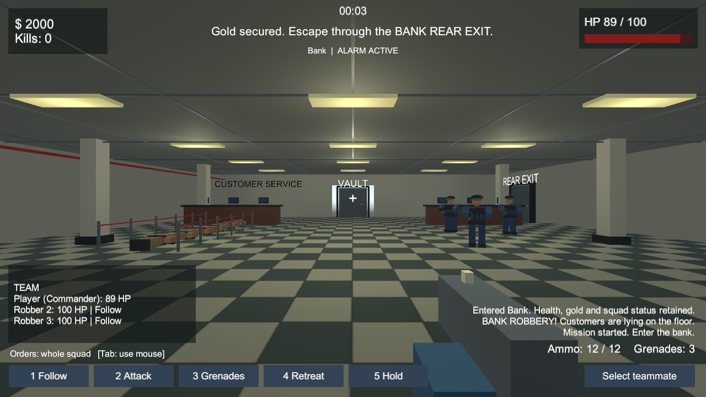

# Bank Heist Game

A bank-heist game project with playable robber, police/guard and bystander roles, squad commands and NPC behavior. This repository preserves the available Unity source project and the separate browser prototype.

## Unity project

Open `unity/` in Unity Hub using Unity **6000.5.7f1**, the version recorded in `unity/ProjectSettings/ProjectVersion.txt`. Open `Assets/Scenes/MainMenu.unity` and press Play. The original project guide, controls and build instructions are in [unity/README.md](unity/README.md).

Source assets, scripts, scenes, package manifests and project settings are included. Unity caches, editor logs, local user settings and Windows builds are excluded. Unity will regenerate its Library directory when the project is first opened.

## Browser prototype

With Python 3 installed, run from the repository root:

```powershell
python -m http.server 8000 --directory web
```

Open http://localhost:8000 in a browser. The prototype uses plain HTML, CSS and JavaScript; no package installation is required. The stylesheet loads Google Fonts when an internet connection is available.

## Version provenance

The supplied folder contained editable source under `outputs/BankHeistUnity` and browser files under `dist`. Those are preserved here as `unity/` and `web/`.

It also contained a compiled Windows build labeled **V33**, but no corresponding V33 Unity source directory. That compiled release and the temporary work scripts are not part of this source repository. The included Unity source must not be treated as the source of V33. The historical Unity QA report is preserved for reference; it is not a fresh test of this prepared repository.



## Verification

Run the preserved browser-engine checks with `node tests/browser-game.cjs` from the repository root. All 14 checks passed during repository preparation. The JavaScript files also passed Node syntax checks. The Unity source files were copied without modification; a fresh Unity editor/build test was not performed.
